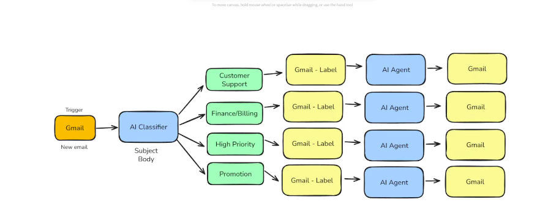
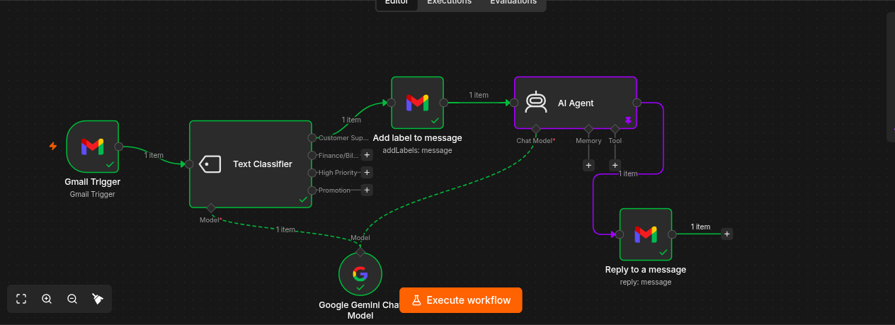
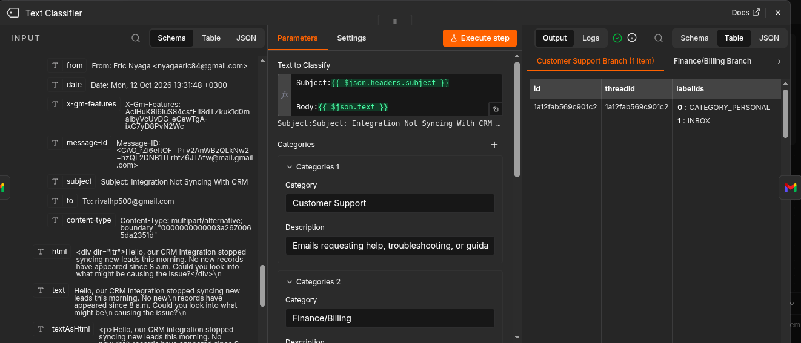

# Inbox Manager Agent (prototype)

**Status:** work in progress. The Customer Support branch is fully wired. The other three branches are planned.

An n8n workflow that watches a Gmail inbox, classifies each new email with AI, labels it, and drafts or sends a reply. I built it to learn polling triggers, LLM classification, routing, and Gmail actions.

## Screenshots

*The design I started from. Based on the Inbox Manager Agent from Nate Herk's tutorial.*

*The current workflow in n8n.*

*Category names and descriptions that steer the classifier.*

## How it works

| Step | Node | What it does |
|------|------|--------------|
| 1 | Gmail Trigger | Checks the inbox on a schedule and starts the workflow for each new email |
| 2 | Text Classifier | Reads the subject and body and picks one category |
| 3 | Gmail: Add label | Tags the email with its category |
| 4 | AI Agent | Writes a reply for that category |
| 5 | Gmail: Reply | Sends the reply |

A Google Gemini Chat Model node supplies the language model for both the classifier and the agent.

## Categories

The classifier uses these definitions (from [`samples/email_labels.csv`](../samples/email_labels.csv)):

| Label | Definition |
|-------|------------|
| Customer Support | Emails requesting help, troubleshooting, or guidance for a product or service. Usually describe issues like login errors, bugs, or malfunctioning features. Common keywords: error, issue, problem, help, access, support, fix, reset, troubleshoot. |
| Finance/Billing | Emails about payments, invoices, refunds, or subscriptions. The sender wants to confirm, dispute, or update financial details. Common keywords: invoice, payment, refund, billing, charge, subscription, renewal, receipt. |
| High Priority | Urgent or time-sensitive emails about critical issues or outages requiring immediate attention. Common keywords: urgent, ASAP, critical, outage, down, immediate, emergency, escalation. |
| Promotion | Marketing or sales-focused emails promoting offers, discounts, or new products. Tone is upbeat and persuasive. Common keywords: sale, offer, discount, promotion, new feature, upgrade, limited time, exclusive. |

## Test emails and results

Five fake emails in [`samples/sample_emails.csv`](../samples/sample_emails.csv), one per category (two for Customer Support). I send each to a practice inbox and compare the classifier's choice with the expected label.

| # | Subject | Expected | Actual | Match? |
|---|---------|----------|--------|--------|
| 1 | Issue Logging Into Dashboard | Customer Support |  |  |
| 2 | Integration Not Syncing With CRM | Customer Support |  |  |
| 3 | Incorrect Charge on Invoice #4782 | Finance/Billing |  |  |
| 4 | System Outage Affecting All Users | High Priority |  |  |
| 5 | New Features + 25% Off Annual Plan | Promotion |  |  |

*Fill in the Actual and Match columns after each test run.*

## Concepts practiced

- **Polling triggers:** n8n checks for new mail every few minutes, unlike an instant webhook
- **Items:** each email is a JSON item that flows from node to node
- **LLM classification:** category descriptions decide how well the AI sorts mail
- **Structured output:** the classifier returns one exact category so routing can follow it
- **Routing:** branches decide what happens to each category
- **Workflow vs agent:** a fixed pipeline with AI inside, versus an AI that chooses its own tools

## Design decisions and safety notes

- **Not every category should end in a reply.** Planned handling:
  - Customer Support: drafted reply
  - Finance/Billing: draft only, since an AI shouldn't confirm refunds or charges on its own
  - High Priority: notify me first instead of auto-replying
  - Promotion: label and archive, with no reply
- **Drafts before sending** while I'm still testing
- **No auto-replies to automated senders** (for example `noreply@` addresses), to avoid reply loops
- **Email content is untrusted input.** The agent prompt should treat the email body as data and never as instructions (prompt injection)
- **Overlapping keywords** (such as "issue" under Customer Support and "down" under High Priority) can confuse the classifier, so High Priority needs an explicit tie-break rule

## Known limitations

- Only the Customer Support branch is connected; Finance/Billing, High Priority, and Promotion have no actions yet
- The reply node currently sends immediately instead of creating a draft
- The workflow only runs while it is published and my laptop and Docker are running
- The Gmail connection expires about every 7 days while my Google app is in Testing mode

## Import it

1. In n8n, create a new workflow, then **⋯ → Import from file** and choose [`workflows/inbox-manager-agent.json`](../workflows/inbox-manager-agent.json).
2. Select your own Gmail and Gemini credentials when prompted. Credential IDs in the file are placeholders.
3. Create the matching Gmail labels first, so the label node has something to attach.

## Next steps

- [ ] Wire up Finance/Billing, High Priority, and Promotion
- [ ] Add a notification for High Priority (Telegram or email)
- [ ] Switch replies to drafts
- [ ] Add a fallback category for emails that fit nothing
- [ ] Run all sample emails and record the results above
